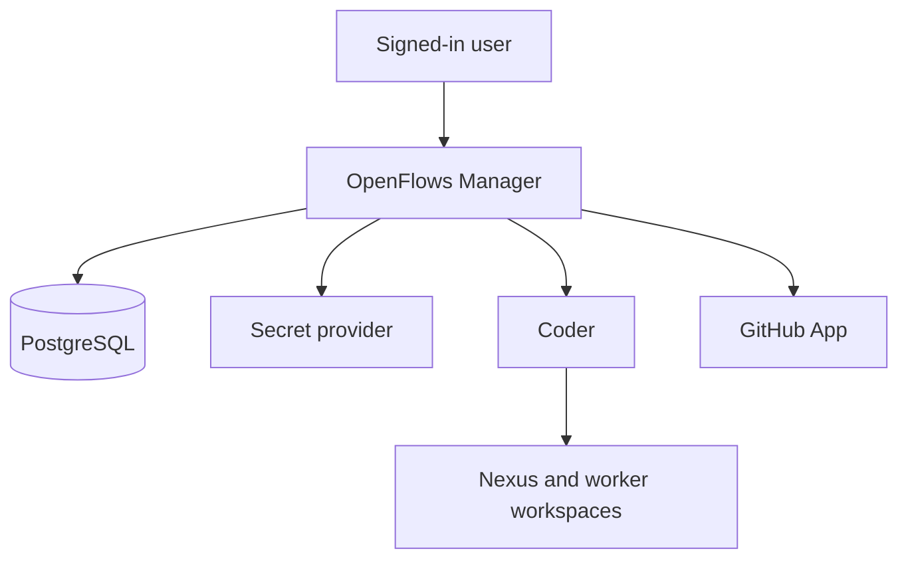
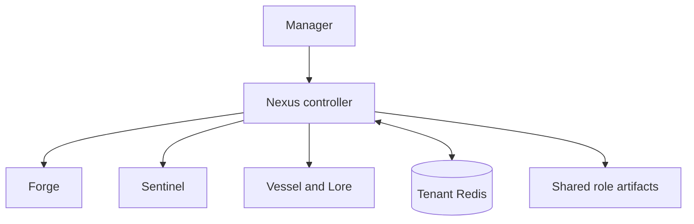

## The control plane and execution plane

Workspaces do not receive Manager's Coder operator credential or GitHub App private key. They authenticate as one registered runtime. Manager is the control plane for provisioning and credential scope, not a proxy for every agent message.

## Inside one tenant

Forge and Sentinel exchange verification through Nexus's tenant-local A2A relay. Manager provisions and scopes those workspaces, but it is not on the A2A message path. Redis holds the tenant coordination state and is protected by tenant-specific credentials.

## Who talks to whom

| Interaction | Authority | Purpose |
| --- | --- | --- |
| User → Manager | Browser session | Sign in, connect GitHub, create an organization and tenant |
| Manager → Coder | Server-held operator credential | Provision templates and workspaces through durable operations |
| Workspace → Manager | One-time bootstrap, then runtime access token | Register, heartbeat, request authorized operations and credentials |
| Manager → GitHub App | Server-held App private key | Mint repository-scoped installation tokens |
| Workspace → GitHub | Short-lived installation token | Synchronize issues, clone, push, and inspect PRs |
| Coder → Manager → Nexus | Global hook signature, then tenant hook signature | Deliver a lifecycle event to the right tenant |
| Nexus ↔ tenant Redis | Tenant Redis ACL and namespace | Store tickets, assignments, heartbeats, hook audit and A2A evidence |
| Sentinel / Forge → Nexus | Ticket pair token | Request, claim and return verification evidence |

> [!INFO] Read the flows next
> Continue to [Manager runtime](/docs/architecture/manager-runtime) for registration and provisioning, then [Credentials and trust](/docs/architecture/credentials) and [Hooks and A2A](/docs/architecture/hooks-and-a2a) for the cross-boundary protocols.
