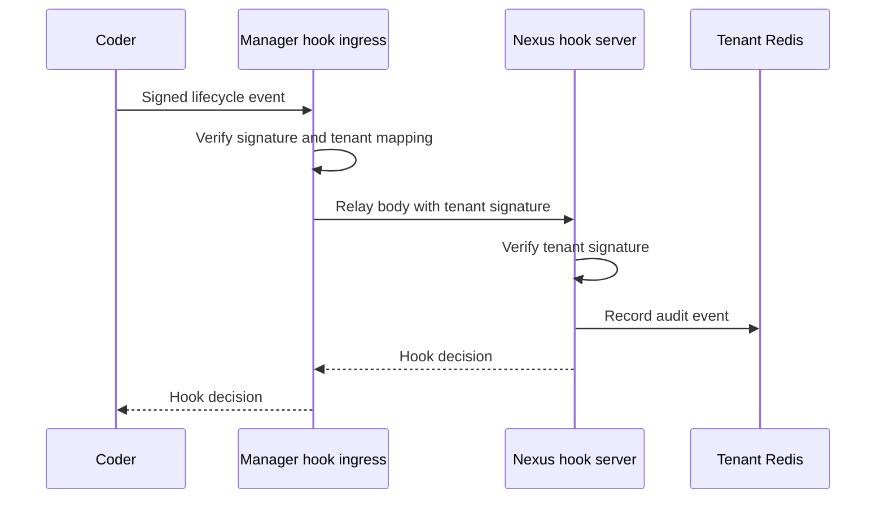
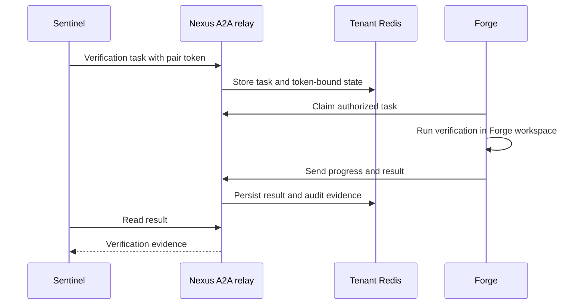

## Coder lifecycle events

1. Coder sends a signed lifecycle event to Manager's `/api/v1/hooks/coder/chat` endpoint.
2. Manager verifies the global signature and payload hash, resolves the Coder workspace to exactly one tenant, then signs the same body with that tenant's hook key.
3. Manager relays the event to the Nexus hook server at `/experimental/hooks/chat`. Nexus verifies the tenant signature, writes an audit event to tenant Redis, and may wake its flow loop.
4. Nexus returns a hook decision through Manager to the Coder sender.

## Agent CLI hooks

Nexus publishes role-specific shell hooks and agent assets to a shared artifacts volume. A Forge or Sentinel workspace copies its own hooks during startup and configures its local agent client. These local scripts call the harness; they are distinct from Coder's HTTP lifecycle events.

## Forge and Sentinel A2A verification

Nexus derives a ticket pair token and stores its hash in tenant Redis. Manager passes the raw token when it creates the paired worker workspaces. Sentinel sends a verification request to the Nexus JSON-RPC relay. Forge claims the task, runs the allowed verification in its own workspace, and sends progress and results back. Sentinel reads the recorded result without entering Forge's filesystem.

The relay stores tasks, results, and audit evidence in tenant Redis so it can recover after a Nexus restart. Manager provisions and scopes the participants, but Forge and Sentinel send A2A traffic directly to Nexus.

> [!INFO] Different tokens
> Coder hook JWTs authenticate lifecycle delivery. A2A pair tokens authenticate one verification pair. Runtime access tokens authenticate workspace calls to Manager. None substitutes for another.
