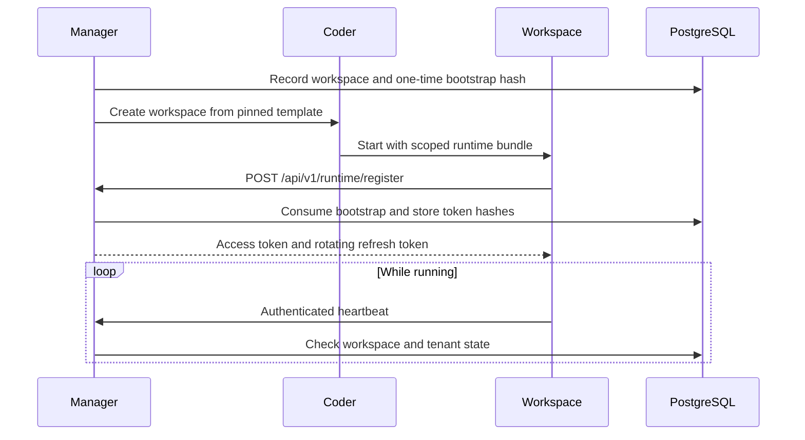
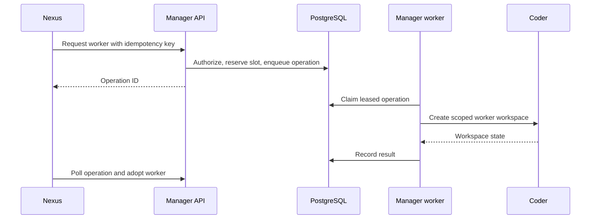

## How a workspace starts



1. Manager records a workspace and prepares a read-only runtime bundle with its workspace ID, tenant ID, Manager URL, one-time bootstrap, Redis access, and tenant hook key.
2. Manager's operation worker asks Coder to create the workspace using a pinned template release.
3. The workspace submits its bootstrap to `POST /api/v1/runtime/register`. Manager consumes it once and returns a short-lived access token and rotating refresh token.
4. The process sends heartbeats to Manager. Manager checks its workspace, tenant, organization, connection, and credential state on privileged requests.

## How Nexus starts workers



Nexus chooses the role, ticket, branch, and slot, then requests a worker through `POST /api/v1/runtime/workspaces` with an idempotency key. Manager verifies that the caller is this tenant's Nexus, reserves capacity, and writes a durable operation. A Manager worker claims the operation and asks Coder to create the Forge, Sentinel, Vessel, or Lore workspace.

Nexus polls the workspace status and adopts the worker once it is running. Database leases let a different Manager instance reclaim provisioning work after a process crash. Repeating the same request does not create a second worker.

## Where state lives

- **PostgreSQL:** resource ownership, operations, runtime credential hashes, generations, and GitHub credential leases.
- **Redis:** tenant coordination, agent heartbeats, worker slots, hook audit, and A2A task evidence, protected by tenant credentials and namespace.
- **Coder:** workspace, build, and agent execution state.
- **Secret provider:** platform keys, bootstrap values, tenant credentials, and mounted runtime bundles.

> [!INFO] Two control loops
> Manager supervises durable workspace operations and runtime registration. Nexus supervises the tenant's issue-to-PR workflow and agent progress.

```cards
- [Credentials and Trust](/docs/architecture/credentials): What each token authorizes and where it lives.
- [Hooks and A2A](/docs/architecture/hooks-and-a2a): How events and agent messages cross workspaces.
```
