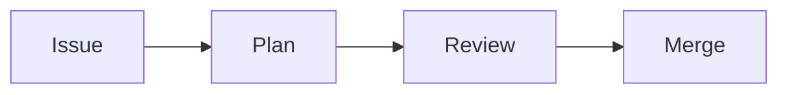

> [!TIP] Nothing goes live by accident
> Every change you make in the editor becomes a draft first. It is only published after it is marked **Ready** and merged, so you can save as often as you like.

## 1. Sign in

Open [openflows.dev/admin](https://openflows.dev/admin) and choose **Sign In with GitHub**. You need write access to the `openflows-website` repository on GitHub. If the button does not work for you, ask a maintainer to add you.

## 2. Find what you want to change

The left column lists everything you can edit:

| In the editor | What it is | Where it appears |
| --- | --- | --- |
| Blog posts | Articles | /blog |
| Research papers | Papers and technical reports | /research |
| Case studies | Stories from teams using OpenFlows | /resources |
| Introduction … Resources | One entry per section of the docs | /docs, in the sidebar |
| Site content → FAQ | The questions and answers | /faq and the homepage |
| Authors | People credited on blog posts | Blog bylines |

Click a section to see its pages in a table. Click a column title to sort by it, and use **Filter** and **Group** to narrow long lists.

## 3. Edit a page and save

Click a page, change the text, then click **Save**. To add a new page, open the section and click **New**.

For docs pages, **Position in the sidebar** decides the order (lower numbers first), and **Short sidebar name** is an optional shorter name for the sidebar. A new docs page appears in its section's sidebar automatically.

## 4. Publish

Saving creates a draft. Open the **Workflow** view (the icon at the top left), then move the change from **Draft** to **In review** so someone can check it, and to **Ready** when it is approved. Publishing merges it, and the website updates a few minutes later.

> [!INFO] Blog post status
> A blog post's **Status** field is separate from publishing. Only posts with Status **published** are listed on the website, so a post can be merged while staying hidden as **draft**.

## Special blocks

In the page content, open **Insert** in the toolbar to add these blocks. This page uses each of them, so you can see what they look like.

### Callout box

A highlighted box that stands out from the text. Pick a kind:

> [!TIP] Tip
> A helpful shortcut or good practice. Shown in green.

> [!INFO] Note
> Background information that is useful but not essential. Shown in blue.

> [!WARNING] Warning
> Something that can go wrong, such as a step that deletes data. Shown in amber.

### Link cards

A grid of clickable boxes, each one leading to another page, with a title and a one-line description. Use them on overview pages so readers can pick what to read next. Each card needs a **Title**, the page it **Links to** (for example `/docs/guides/troubleshooting`) and an optional **Description**:

```cards
- [Quick start](/docs/getting-started): Install OpenFlows and run your first issue.
- [Troubleshooting](/docs/guides/troubleshooting): Fix the most common problems.
```

### Numbered steps

Write a heading that starts with a number and a full stop, such as `1. Sign in`. It is shown with a round number badge, like the headings at the top of this page.

### Diagram

A drawing made from a few lines of text, using [Mermaid](https://mermaid.js.org). For example, `flowchart LR` followed by `Issue --> Plan --> Review --> Merge` draws:



Try a diagram at [mermaid.live](https://mermaid.live) first, then paste the text into the block.

## Images

Use the image button in the toolbar, or the **Cover image** field on blog posts. Uploaded files are stored with the website and get a web-safe name automatically.
